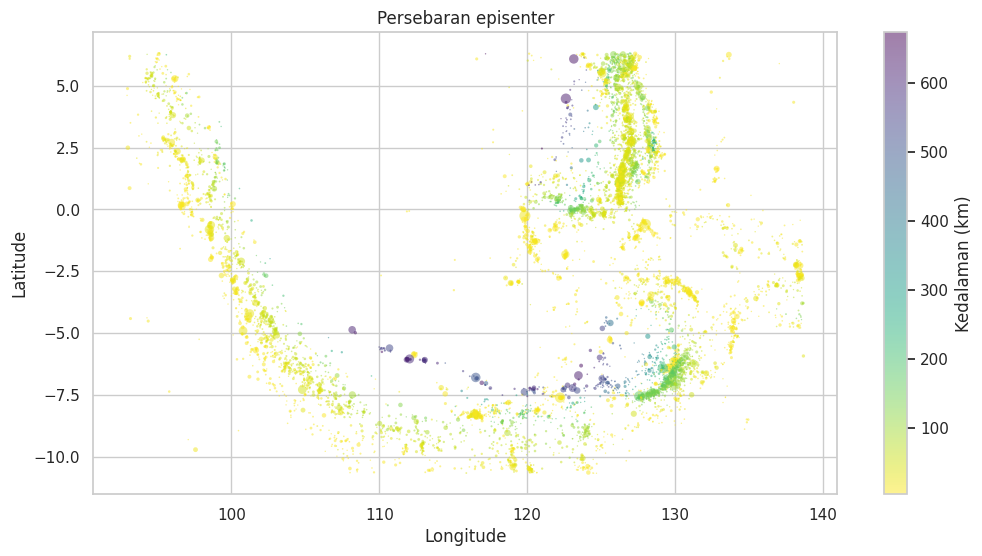
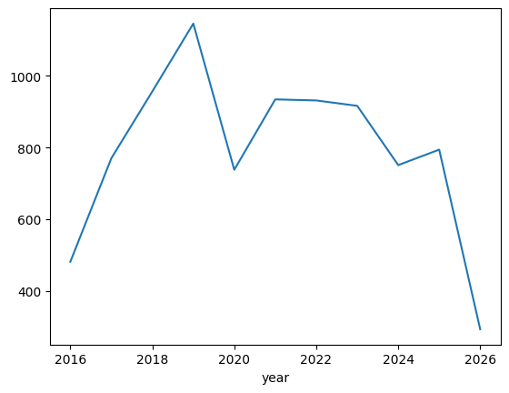
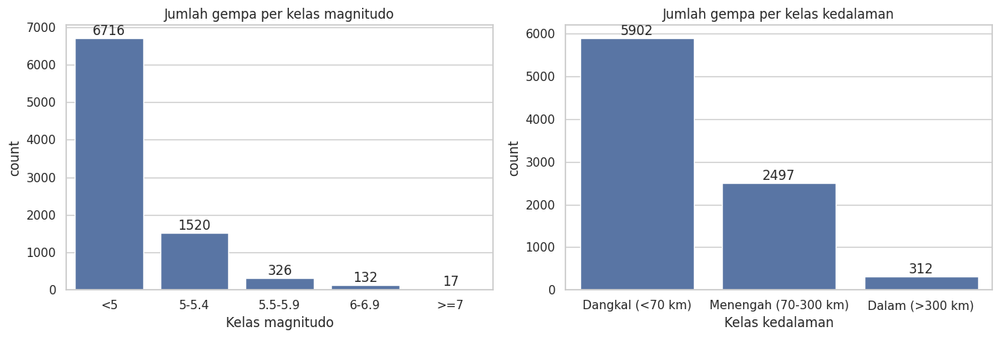

# Analisis dan Prediksi Magnitudo Gempa Indonesia (2016–2026)

EDA dan model machine learning sederhana pada katalog gempa 10 tahun terakhir di Indonesia (8.711 kejadian, Maret 2016 – April 2026).

- **Data:** [Kaggle – nnares/earthquake-data-from-the-past-10-years](https://www.kaggle.com/datasets/nnares/earthquake-data-from-the-past-10-years) 
- **Tools:** Python, pandas, seaborn, scikit-learn

## Hasil

| Model | MAE | RMSE | R² |
|---|---|---|---|
| Random Forest Regressor | 0.114 | 0.175 | 0.778 |

Persebaran episenter (ukuran = magnitudo, warna = kedalaman):



<details>
<summary><b>Step 1: Load Data & Cleaning</b></summary>

- Baca CSV, cek nilai kosong dengan `isnull().sum()`
- Isi `magNst` dan `nst` dengan median, `magError` dengan rata-rata
</details>

<details>
<summary><b>Step 2: EDA</b></summary>

- Distribusi magnitudo dan hubungan magnitudo vs kedalaman
- Frekuensi gempa per grid lat/long, tren jumlah gempa per tahun
- Gempa anomali (M > 7.5)


</details>

<details>
<summary><b>Step 3: Modeling</b></summary>

- Target: `mag`. Fitur: `latitude`, `longitude`, `depth`, `nst`, `magNst`, `magError`
- Random Forest (200 pohon), split 80/20
- Evaluasi: MAE, RMSE, R²
</details>

<details>
<summary><b>Step 4: EDA Lanjutan</b></summary>

- 6.716 dari 8.711 gempa berada di bawah M 5, dan hanya 17 gempa ≥ M 7
- 5.902 gempa (≈68%) tergolong dangkal (< 70 km)
- Wilayah terbanyak: Tobelo (891), Ternate (542), Sarangani (398)


</details>

<details>
<summary><b>Catatan & Keterbatasan</b></summary>

- Model memperkirakan **magnitudo**, bukan waktu atau lokasi gempa berikutnya.
- `magNst` dan `magError` baru diketahui setelah magnitudo dihitung, sehingga R² 0,778 kemungkinan terlalu optimistis. Perlu dicoba tanpa kedua fitur ini dan dengan split berdasarkan waktu.
</details>

## Cara Menjalankan

```bash
git clone https://github.com/naaresn/earthquake-eda-prediction.git
cd earthquake-eda-prediction
pip install -r requirements.txt
jupyter notebook notebooks/earthquake_eda_prediction.ipynb
```

## Struktur

```
├── data/          
├── notebooks/     
├── images/        
├── requirements.txt
└── README.md
```
